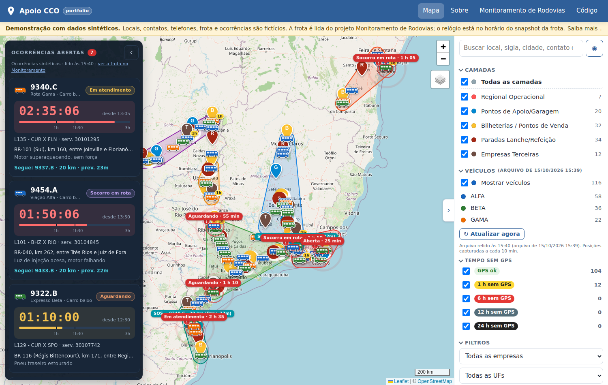
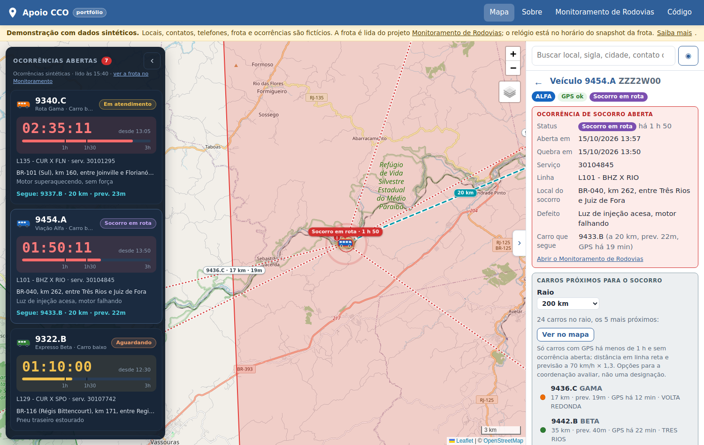
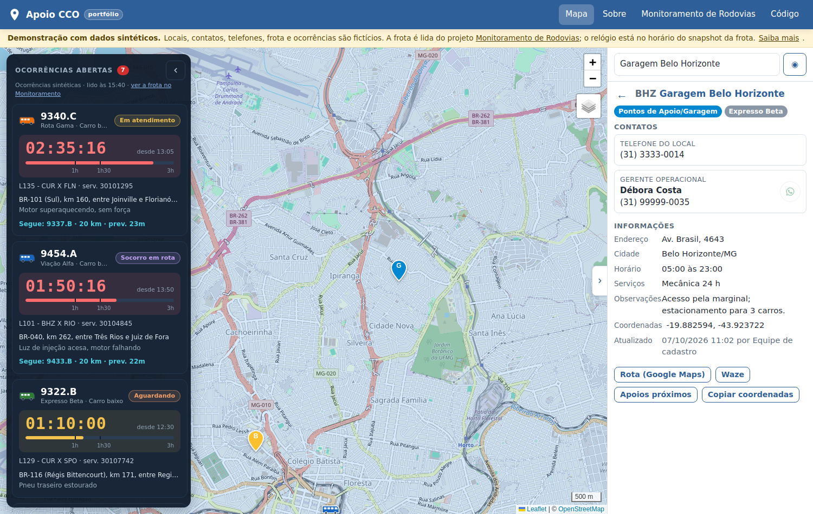
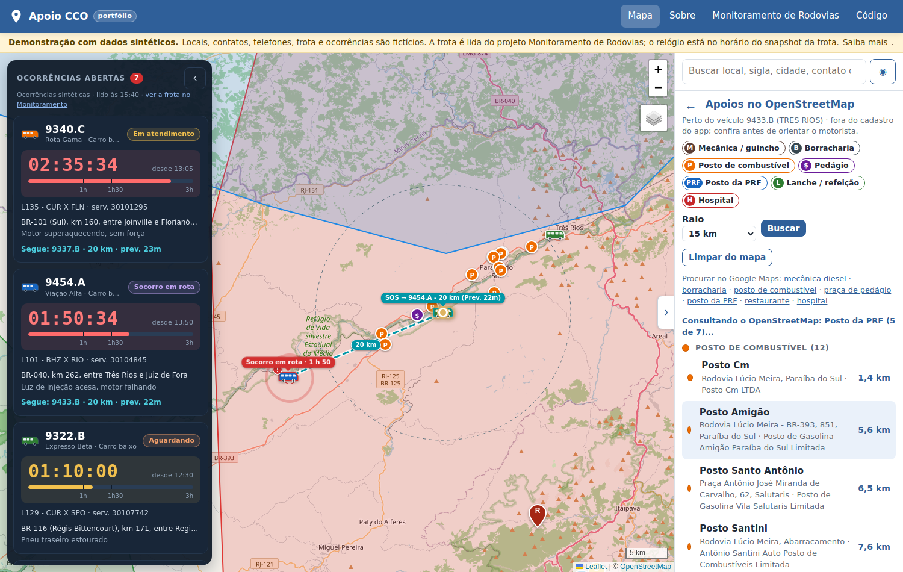

# Apoio CCO

Mapa de apoio ao centro de controle operacional (CCO) de uma empresa de ônibus rodoviários: pontos de apoio e garagens, bilheterias, paradas de refeição, empresas terceiras e regionais, com contatos, a última posição de cada carro, as ocorrências de socorro abertas, carros candidatos a atender um socorro e uma busca de apoios fora do cadastro no OpenStreetMap.

> **Aviso sobre os dados.** Tudo aqui é **sintético**: locais, contatos, telefones, regionais e ocorrências são gerados por `scripts/gerar_dados_sinteticos.py` (seed fixa), sem derivar de nenhum registro real; a frota (carros, placas e posições GPS) vem do projeto irmão [Monitoramento de Rodovias](https://github.com/danielmvr/monitoramento-rodovias-portifolio), que também é sintético. Os telefones são fictícios e os botões de WhatsApp ficam desativados. Esta é uma versão de portfólio, separada do sistema em produção.

**Versão web:** https://danielmvr.github.io/apoio-cco-portifolio/

## Objetivo

Antes, a coordenação do CCO consultava um mapa compartilhado (Google My Maps) com os telefones de garagens, oficinas, bilheterias e paradas em texto livre, sem controle de acesso, sem a posição dos carros e sem ligação com as ocorrências. O sistema original substitui esse mapa por um app com login, perfis de acesso, cadastro estruturado de locais e contatos, auditoria e importação do KML antigo, e cruza três fontes numa tela só:

- **Locais de apoio** por camada (garagem, bilheteria, parada, terceiro, regional), com busca por nome, sigla, cidade, serviço ou contato, filtros por empresa e UF e "apoios mais próximos" de qualquer ponto.
- **Frota**: última posição de cada carro, lida de um CSV de posições (vírgula decimal, 13 ou 16 campos), com faixas de tempo sem GPS (1 h, 6 h, 12 h, 24 h) e filtro por empresa e por faixa.
- **Ocorrências de socorro**: carro quebrado em destaque no mapa, painel com cronômetro desde a quebra, carro que segue para o socorro (linha até o carro quebrado, distância e previsão de chegada) e os carros candidatos a atender o socorro (GPS recente, sem ocorrência, num raio de 100 a 300 km).
- **Apoios fora do cadastro**: mecânica, borracharia, posto, pedágio, PRF, lanche e hospital num raio de 5 a 60 km, consultados no Nominatim (OpenStreetMap), com links para Google Maps, Waze e OSM.

## Capturas de tela

| Mapa geral | Ocorrência, carro que segue e candidatos ao socorro |
|---|---|
|  |  |
| **Local de apoio com contatos** | **Apoios no OpenStreetMap em volta de um carro** |
|  |  |

As capturas são feitas da versão publicada pelo workflow `.github/workflows/capturas.yml` (Playwright).

## Stack

- **Versão de portfólio (este repositório):** HTML, CSS e JavaScript puros, Leaflet 1.9.4 e Leaflet.markercluster (vendorizados), tiles do OpenStreetMap e da Esri, Nominatim para a busca de apoios; Python 3 para o gerador de dados e as capturas; GitHub Pages para a hospedagem.
- **Sistema original:** Python com Django 5.2 LTS, Postgres, o mesmo front-end em Leaflet, Argon2 e cabeçalhos de segurança (CSP, HSTS), perfis Admin/Editor/Leitura, auditoria, importação e exportação de KML e Excel, hospedado em nuvem. O que depende do servidor (login, cadastro, importação, exportação, auditoria) não entra nesta versão.

## Como funciona

1. **Dados** (`scripts/gerar_dados_sinteticos.py`): 38 cidades com coordenadas públicas e siglas de 3 letras, as mesmas do Monitoramento de Rodovias; 5 camadas; ~110 locais (garagens, bilheterias, paradas na cidade e no meio dos corredores, terceiros) com 1 a 4 contatos cada; 7 regionais desenhadas como polígonos (casco convexo em volta das cidades que cobrem); 7 ocorrências de socorro referindo carros da frota, com status, carro que segue e tempos relativos ao "agora" do snapshot.
2. **Camada de dados** (`assets/js/dados.js`): substitui a API do servidor. Lê os JSON de `data/`, baixa o CSV de posições e o `meta.json` direto do repositório do Monitoramento de Rodovias (`raw.githubusercontent.com`, com `data/frota/` como reserva), interpreta o CSV com vírgula decimal, calcula a faixa de tempo sem GPS, cruza as ocorrências pelo número do carro, mede distâncias (haversine) e a previsão de chegada (distância × 1,3 a 70 km/h) e consulta o Nominatim uma categoria por vez, com 1 pedido por segundo e cache de 1 h. O relógio da página começa no "agora" do snapshot da frota e avança em tempo real, por isso os cronômetros correm.
3. **Mapa** (`assets/js/mapa.js`): o front-end do sistema original, com as chamadas `fetch` trocadas pelas funções de `dados.js`. Camadas com agrupamento, lateral recolhível, painel escuro flutuante das ocorrências, menu de contexto no mapa, busca, filtros e deep link `#l=ID`.

## Relação com o Monitoramento de Rodovias

Os dois projetos formam um par: o [Monitoramento de Rodovias](https://github.com/danielmvr/monitoramento-rodovias-portifolio) ([versão web](https://danielmvr.github.io/monitoramento-rodovias-portifolio/)) acompanha ocorrências nas rodovias, a posição dos carros e os atrasos; o Apoio CCO mostra onde estão os apoios e quem chamar quando um carro precisa de socorro. Eles compartilham as mesmas entidades sintéticas: as 38 cidades e siglas, as empresas fictícias (Viação Alfa, Expresso Beta e Rota Gama, sufixos `.A`, `.B` e `.C` dos carros), os carros e suas placas e o mesmo layout de CSV de posições. O Apoio CCO consome a frota diretamente do repositório do Monitoramento: se os dados forem regerados lá, o mapa aqui muda na próxima abertura ou no botão "Atualizar agora".

## Como executar

**Na web:** abra https://danielmvr.github.io/apoio-cco-portifolio/.

**Localmente** (qualquer servidor de arquivos estáticos; o `file://` não serve porque a página lê JSON por `fetch`):

```bash
git clone https://github.com/danielmvr/apoio-cco-portifolio.git
cd apoio-cco-portifolio
python -m http.server 8000
# abra http://localhost:8000/
```

**Regerar os dados sintéticos** (mesma seed, mesmo resultado):

```bash
python scripts/gerar_dados_sinteticos.py                  # usa a cópia da frota em data/frota/
python scripts/gerar_dados_sinteticos.py --baixar         # antes, atualiza data/frota/ a partir do GitHub
python scripts/gerar_dados_sinteticos.py --fluxo ../monitoramento-rodovias-portifolio   # ou de um clone local
```

**Capturas de tela** (Playwright):

```bash
pip install playwright && python -m playwright install chromium
python scripts/capturar_telas.py http://localhost:8000/
```

## Estrutura

```
index.html                    página única (GitHub Pages)
assets/
  css/app.css                 estilos do sistema original
  css/portfolio.css           faixa de aviso e diálogo "Sobre" desta versão
  js/mapa.js                  mapa (Leaflet + MarkerCluster), front-end do sistema original
  js/dados.js                 camada de dados estática: JSON, CSV da frota, ocorrências, Nominatim
  js/app.js                   menu e diálogo
  vendor/                     Leaflet 1.9.4 e Leaflet.markercluster (BSD-2 / MIT)
data/
  camadas.json, locais.json, ocorrencias.json, meta.json   dados sintéticos gerados
  frota/                      cópia do CSV de posições e do meta.json do Monitoramento de Rodovias
scripts/
  gerar_dados_sinteticos.py   gerador reprodutível (seed 42)
  capturar_telas.py           capturas para este README
docs/img/                     capturas de tela
.github/workflows/capturas.yml  atualiza as capturas a partir da versão publicada
```

## Proteção de dados

No sistema original os contatos são dados pessoais de funcionários e parceiros: ficam atrás de login, são carregados sob demanda, cada consulta é registrada em auditoria e há termo de uso, retenção configurável e documento de mapeamento (LGPD). Esta versão pública não contém nenhum registro real: nomes, telefones, placas e posições são inventados por script, e nenhum arquivo do sistema em produção foi usado como fonte.

## Licença

MIT. Leaflet (BSD-2-Clause) e Leaflet.markercluster (MIT) têm suas licenças em `assets/vendor/`.
